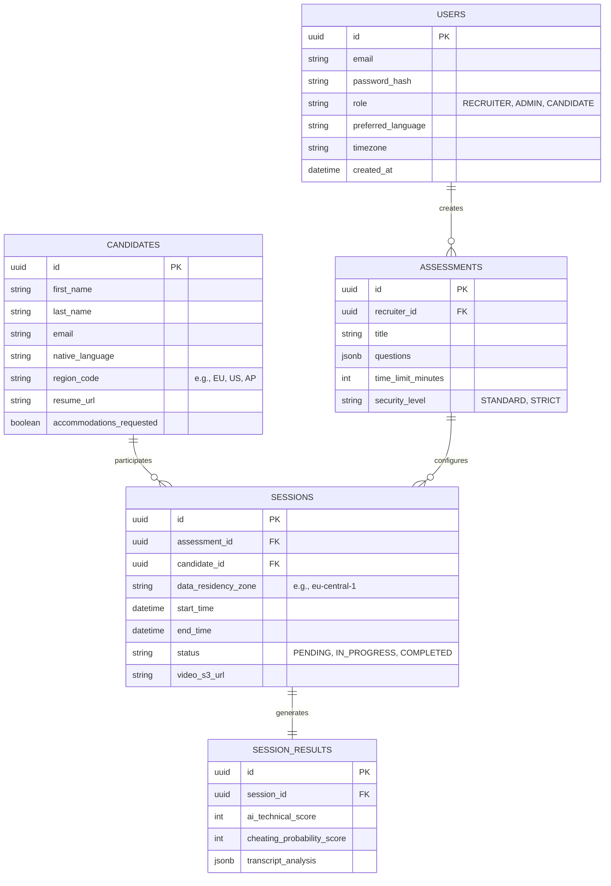

# Backend Schema & Database Architecture

## 1. Database Strategy
The platform utilizes a polyglot persistence strategy to handle different data access patterns efficiently:
- **PostgreSQL:** Primary relational database for Users, Roles, Assessments, and Interview Sessions.
- **MongoDB:** NoSQL document store for high-volume, unstructured telemetry data, CV tracking logs, and AI transcriptions.
- **Redis:** In-memory data store for real-time WebSocket session management and temporary state caching.
- **Amazon S3:** Object storage for video/audio recordings and ID verification images.

## 2. Entity-Relationship Diagram (ERD)



## 3. Telemetry & Biometrics Schema (MongoDB)

Since tracking data is generated continuously (e.g., every frame or keystroke), it is stored in MongoDB as time-series documents.

**Collection: `tracking_logs`**
```json
{
  "_id": "ObjectId",
  "session_id": "uuid",
  "timestamp": "ISODate",
  "event_type": "GAZE_DEVIATION | HAND_OUT_OF_FRAME | AUDIO_ANOMALY | KEYSTROKE_ANOMALY",
  "severity": "LOW | MEDIUM | HIGH",
  "details": {
    "gaze_angle": 32.5,
    "duration_ms": 1500,
    "snapshot_s3_url": "s3://bucket/snapshots/uuid.jpg"
  }
}
```

**Collection: `cognitive_fingerprints`**
```json
{
  "_id": "ObjectId",
  "candidate_id": "uuid",
  "session_id": "uuid",
  "keystroke_metrics": {
    "average_dwell_time_ms": 85,
    "average_flight_time_ms": 120,
    "variance": 15.2
  },
  "mouse_metrics": {
    "movement_linearity_score": 0.85
  },
  "is_bot_flag": false
}
```

## 4. Data Security & Encryption Strategy

1. **PII and Biometric Data Encryption:** All Personally Identifiable Information (PII) in PostgreSQL is encrypted at rest using AES-256. Biometric baseline data (facial scans, voice prints) are irreversibly hashed and never stored in plain text.
2. **Ephemeral Telemetry:** Detailed tracking logs (MongoDB) are retained only for the duration of the hiring cycle. An automated cron job purges telemetry data 30 days after the `SESSION_RESULTS` are marked as reviewed, leaving only the aggregated `cheating_probability_score`.
3. **Signed URLs:** Access to S3 video recordings and snapshots is strictly controlled via short-lived pre-signed URLs generated by the API Gateway, ensuring that media assets cannot be accessed publicly.
