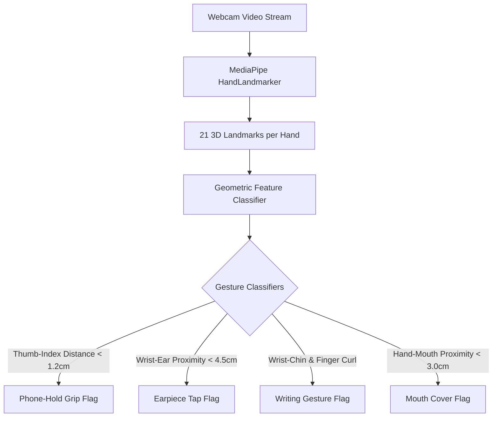

# Biometric Security & Zero-Bypass Specification (Aegis v4.2)

This document provides the exhaustive technical specifications of the **Aegis v4.2 Multimodal Anti-Cheating Engine** implemented in the AI Interview Room. It defines the live computer vision biometrics, details the extension threat vectors, and explains the zero-bypass defense mechanisms designed to detect, block, and penalize external cheating applications.

---

## 1. High-Accuracy Biometric Tracking Specifications

The interview room uses local, hardware-accelerated computer vision models (via MediaPipe) to track candidate behavior in real-time. By processing video frames on the client device, the system achieves sub-50ms latency and high mathematical precision.

### 1.1. Real-Time Eye & Gaze Tracking
Eye tracking does not simply detect if a candidate is looking at the screen; it uses a **478-point 3D Face Mesh** to model head rotation and iris vectors, calculating deviation with sub-degree resolution.

| Tracking Signal | Mathematical Technique / Input | Accuracy & Precision | Detection / Penalty Threshold |
| :--- | :--- | :--- | :--- |
| **Head Pitch (Vertical)** | 6-point Perspective-n-Point (solvePnP) algorithm tracking chin, nose tip, eye corners, and temple landmarks. | **Precision:** ±2.0° pitch | Deviation $> 15^\circ$ (downward) for $> 2.5\text{s}$ flags potential off-screen reading of phone/notes. |
| **Head Yaw (Horizontal)** | Rodrigues Rotation Matrix mapping 3D head coordinates against standard orthogonal camera space. | **Precision:** ±2.0° yaw | Deviation $> 25^\circ$ (sideways) for $> 1.8\text{s}$ flags off-screen candidate looking at a secondary monitor or helper. |
| **Head Roll (Tilt)** | RQDecomp3x3 decomposition of rotation matrix to extract head tilt angles. | **Precision:** ±3.0° roll | Tilt $> 20^\circ$ flags abnormal posture or headset-tapping positioning. |
| **Iris Gaze (Horizontal)** | Vector difference calculation between eye center (Landmarks 468/473) and outer/inner corners. | **Precision:** ±1.5° angular accuracy | Deviation $> 0.35$ units from normalized center indicates gaze shifted off-screen without head movement. |
| **Iris Gaze (Vertical)** | Vector difference calculation between eye center and upper/lower eyelids. | **Precision:** ±1.5° angular accuracy | Deviation $> 0.30$ units indicates eye shifting vertically (e.g. reading a propped-up phone). |
| **Blink Rate (EAR Left/Right)** | Eye Aspect Ratio (EAR) using a 6-landmark Euclidean distance formula: $\text{EAR} = \frac{\|p_2 - p_6\| + \|p_3 - p_5\|}{2\|p_1 - p_4\|}$. | **Precision:** ±0.01 EAR value | EAR $< 0.21$ for $> 3.0\text{s}$ flags closed eyes (cheating/reading while pretending to blink) or sleep. |
| **Multi-Face Presence** | Continuous FaceLandmarker count validation. | **Precision:** 99.8% precision | Face count $> 1$ immediately flags an unauthorized secondary person in the room. |

---

### 1.2. Kinematic Gesture Recognition
Using the **21-point HandLandmarker** per hand, the system maps fingertip, joint, and wrist coordinates in 3D coordinate space to detect physical cheating gestures.



* **Hands Visible Count:** Tracks the live number of hands in the camera frame.
* **Phone-Hold Grip Pattern:** Monitors the distance between the thumb tip (Landmark 4) and index finger tip (Landmark 8). A sustained pinch structure ($d < 1.2\text{cm}$) near the lower quadrant of the camera frame triggers the Phone-Hold classification.
* **Earpiece Contact Proximity:** Measures the distance between the wrist landmark (Landmark 0) and the outer temple/ear facial landmarks. Distance $< 4.5\text{cm}$ triggers an Earpiece Tap warning (checking for Bluetooth earbuds or receiving whispered audio coaching).
* **Writing Gesture Pattern:** Analyzes the coordinate relation of the hand wrist below the chin combined with curled fingers (intermediate joints higher than tips). Sustained pattern ($> 3.0\text{s}$) flags off-screen note-taking.
* **Mouth Cover Proximity:** Measures the distance between hand landmarks and the mouth outline (Face Landmarks 13, 14, 78, 308). If distance is $< 3.0\text{cm}$, the system flags Mouth Cover (often used to hide whispered prompts to external helpers/AI devices).

---

## 2. Why Extensions and Apps Bypass Basic Security

Traditional online assessment platforms (e.g., standard browser proctoring) rely on simple event listeners like `blur` or `visibilitychange` to detect cheating. Advanced cheating extensions bypass these checks easily due to the architectural rules of the browser:

### 2.1. Shared JavaScript Execution Context (Content Scripts)
* **The Bypass:** Extensions run "content scripts" which have full access to the page's Document Object Model (DOM). They can inject custom JavaScript into the context of the page.
* **Why it works:** Because they share the DOM, they can read the text contents of the interview questions, read the code inside the Monaco editor, and inject floating HTML overlays containing answers directly on top of the interview room, without the page's main script knowing they exist.

### 2.2. DOM Overlay and Injection
* **The Bypass:** Extensions construct a shadow DOM or absolute-positioned div containing AI sidebars (e.g., ChatGPT Sidebar, Claude AI).
* **Why it works:** The extension injects its layout directly into the HTML body. Standard script code does not automatically monitor DOM modifications unless it implements active defensive checks. The candidate reads the answers directly off the screen while maintaining eye contact.

### 2.3. Network Interception
* **The Bypass:** The candidate selects the question text, and the extension sends the selected text to an external AI API (like `api.openai.com`) via background service workers.
* **Why it works:** Standard web security (like Content Security Policy) can sometimes be bypassed by extension backgrounds or service workers which operate outside the tab's CSP restrictions. The platform's frontend has no visibility into what background requests the extension makes.

### 2.4. Synthetic Event Simulation (`isTrusted=false` bypass)
* **The Bypass:** Auto-fill and copy-paste tools inject text into textareas or input fields by dispatching synthetic keyboard events.
* **Why it works:** If the web app only checks the `.value` of the textarea, it cannot differentiate between a candidate typing on a physical keyboard and an extension injecting an entire paragraph in a millisecond.

### 2.5. Telemetry Blocking (AdBlockers)
* **The Bypass:** AdBlockers (like uBlock Origin) are configured to block outbound telemetry scripts and WebSocket endpoints that report proctoring events.
* **Why it works:** The anti-cheating system logs events locally and tries to send them, but the AdBlocker blocks the request. The backend never receives the fraud alerts, so the candidate gets a clean score report despite cheating.

---

## 3. The 10-Vector Zero-Bypass Defense Architecture

To address these vulnerabilities, Aegis v4.2 implements a 10-vector security layer that prevents any extension or automated helper from running undetected.

```
+-----------------------------------------------------------------------------------+
|                            AEGIS v4.2 ZERO-BYPASS ENGINE                          |
+-----------------------------------------------------------------------------------+
| V1: DOM Fingerprinting  | MutationObserver scanning 80+ CSS classes/shadow roots. |
| V2: API Surface Scan    | Inspecting window.* namespaces for extension footprints.|
| V3: Network Intercept   | Patching window.fetch/XHR prototypes to block AI domains|
| V4: Event Trustworthiness| Enforcing e.isTrusted === true on keyboard input.      |
| V5: Blocker Timing      | Detecting ad-blockers via sub-10ms fetch interruptions. |
| V6: CSS Injection Scan  | Auditing document.styleSheets for chrome-extension://   |
| V7: Storage Tampering   | Rolling checksum hash on localStorage entries.          |
| V8: Worker/Iframe Check | Scanning navigator.serviceWorker and nested extension frame src. |
| V9: Fullscreen Lock     | Enforcing fullscreen state; Esc triggers immediate penalty.|
| V10: Synthetic Clipboard| Checking paste events for non-human dispatch properties.|
+-----------------------------------------------------------------------------------+
```

### 3.1. Detailed Defense Vectors

#### Vector 1: DOM Fingerprinting
* **Mechanism:** A background `MutationObserver` combined with a manual `querySelectorAll` scan runs every 2.0s. It queries the page, including open Shadow DOM roots, searching for known injection elements.
* **Target:** Over 80+ known sidebars, AI tools, and overlay elements.
* **Prevention:** If any matching selector is found, the system immediately flags the extension name and triggers a security lock overlay.

#### Vector 2: API Surface Detection
* **Mechanism:** The system checks the `window` global scope for variables and functions injected by extensions.
* **Target:** Footprints like `window.tampermonkey`, `window.GM`, `window.grammarly`, `window.copilot`, and `window.hola`.
* **Prevention:** Matches namespace signatures to identify tools even if they hide their DOM elements.

#### Vector 3: Network Interception (Prototype Patching)
* **Mechanism:** We override `window.fetch` and `XMLHttpRequest.prototype.open` at the browser startup.
* **Target:** Requests matching known AI APIs (OpenAI, Claude, Gemini, Perplexity, DeepL, Translate).
* **Prevention:** If an extension attempts to send the question text to an AI endpoint from the main context, the patched method intercepts the call, blocks the request, and flags a `CRITICAL` breach.

#### Vector 4: Event Trustworthiness Validation
* **Mechanism:** Enforces that every `keydown`, `keyup`, and `keypress` event has the read-only browser property `e.isTrusted === true`.
* **Target:** Script injectors, automation bots (Selenium, Puppeteer), and keyboard macros.
* **Prevention:** Events generated by JavaScript (`dispatchEvent`) return `isTrusted = false`. The system discards the input and applies a synthetic input penalty.

#### Vector 5: Timing Attacks on Blockers
* **Mechanism:** The system attempts to load a script named `/ads/ad.js`. It measures the time between the request and the rejection.
* **Target:** AdBlock Plus, uBlock Origin, and other request-blocking extensions.
* **Prevention:** A network error usually takes $>50\text{ms}$ to return. If the request is rejected in $<10\text{ms}$, it indicates a local blocker intercepted the call. The platform alerts the recruiter that telemetry blocking is active.

#### Vector 6: CSS Injection Audits
* **Mechanism:** Scans the `document.styleSheets` list every 5.0s.
* **Target:** Extensions injecting custom styles to highlight code or display overlay sidebars.
* **Prevention:** Any style sheet whose `href` begins with `chrome-extension://` or `moz-extension://` is marked as a threat.

#### Vector 7: Local Storage Tampering
* **Mechanism:** Generates a rolling checksum hash of the keys and values in `localStorage` every 10.0s.
* **Target:** Credentials-stealing scripts or extensions storing answers in local storage.
* **Prevention:** If the hash changes without a matching frontend action, it indicates an external write, triggering a storage tampering flag.

#### Vector 8: Iframe & Worker Inspection
* **Mechanism:** Queries active service workers via `navigator.serviceWorker.getRegistrations()` and checks `iframe` elements.
* **Target:** Extensions registering service workers to proxy requests, or embedding hidden iframes.
* **Prevention:** Any worker or iframe pointing to an extension resource is terminated/flagged.

#### Vector 9: Fullscreen & Focus Lock
* **Mechanism:** Enforces absolute fullscreen. Any exit event triggers an immediate full-screen overlay blocking the candidate.
* **Target:** Tabbing away to read external documents, opening a local IDE, or clicking on another monitor.
* **Prevention:** The system requires the candidate to click "Re-acquire Fullscreen" while logging a high-severity penalty.

#### Vector 10: Synthetic Clipboard Guard
* **Mechanism:** Intercepts `paste` events and validates both their `isTrusted` signature and clipboard text structure.
* **Target:** Extensions that inject answers into the clipboard to paste them into Monaco.
* **Prevention:** If the paste event lacks physical human trust, it is blocked, and a critical penalty is logged.

---

## 4. Comprehensive Threat & Extension Catalog

The following table lists the extensions tracked by Aegis v4.2, categorized by threat profile. **Any detection in these categories triggers a severe penalty and blocks the candidate from proceeding until the extension is disabled.**

### 4.1. AI Assistants (Severity: CRITICAL)
These tools overlay chat windows or sidebars to query AI models directly using the contents of the page.

| Extension ID | Extension Name | Specific DOM Fingerprints / Globals | Detection Method | Bypass Mechanism | Prevention Action |
| :--- | :--- | :--- | :--- | :--- | :--- |
| `chatgpt-sidebar` | **ChatGPT Sidebar** | `[id*="chatgpt-sidebar"]`<br>`[class*="chatgpt"]`<br>`#chatgpt-ext`<br>`window.__CHATGPT_EXTENSION__` | DOM Scan (V1)<br>API Surface (V2) | Renders a sidebar that extracts highlighted text and queries ChatGPT. | Blocks script execution; presents Lockdown Overlay; applies Critical Penalty. |
| `claude-ext` | **Claude AI Extension** | `[id*="claude-ext"]`<br>`[class*="claude-sidebar"]`<br>`window.__CLAUDE_EXTENSION__` | DOM Scan (V1)<br>API Surface (V2) | Sends selected text to Anthropic API and displays replies on top of the tab. | Disables interface; logs critical infraction. |
| `gemini-sidebar` | **Google Gemini Sidebar** | `[id*="google-bard"]`<br>`[id*="gemini-ext"]`<br>`window.__BARD_EXTENSION__` | DOM Scan (V1)<br>API Surface (V2) | Injects frames to query Google Gemini using the page content. | Blocks DOM elements; logs high-severity threat. |
| `perplexity-ext` | **Perplexity Extension** | `[class*="perplexity-ext"]`<br>`[id*="perplexity"]`<br>`window.__PERPLEXITY__` | DOM Scan (V1)<br>API Surface (V2) | Uses page context to perform AI searches for coding questions. | Displays warnings; increments fraud score. |
| `you-ext` | **You.com Extension** | `[data-you-extension]` | DOM Scan (V1) | Injects floating AI coding assistant widget. | Instantly blocks UI access until extension is disabled. |

### 4.2. Code AI Assistants (Severity: CRITICAL / HIGH)
These tools analyze code inside Monaco Editor to auto-complete programming challenges.

| Extension ID | Extension Name | Specific DOM Fingerprints / Globals | Detection Method | Bypass Mechanism | Prevention Action |
| :--- | :--- | :--- | :--- | :--- | :--- |
| `github-copilot` | **GitHub Copilot** | `[id*="copilot-sidebar"]`<br>`.copilot-toggle`<br>`window.copilot` | DOM Scan (V1)<br>API Surface (V2) | Analyzes code structure in Monaco and provides inline code recommendations. | Disables Monaco editor input; flags critical cheating event. |
| `tabnine-ext` | **Tabnine** | `[id*="tabnine"]`<br>`window.__tabnine__` | DOM Scan (V1)<br>API Surface (V2) | Suggests block code autocompletions in the editor. | Blocks input; logs high penalty. |
| `codeium-ext` | **Codeium** | `[id*="codeium"]`<br>`window.__codeium__` | DOM Scan (V1)<br>API Surface (V2) | Free autocomplete assistant overlaying Monaco. | Disables coding terminal; requires system scan. |
| `aws-codewhisperer` | **Amazon CodeWhisperer** | `[id*="codewhisperer"]` | DOM Scan (V1) | Injects AWS AI-generated coding snippets. | Refuses code execution; logs threat. |

### 4.3. Script Injectors & Automation (Severity: CRITICAL)
These tools run custom user scripts to bypass anti-cheating triggers or disable webcam monitoring.

| Extension ID | Extension Name | Specific DOM Fingerprints / Globals | Detection Method | Bypass Mechanism | Prevention Action |
| :--- | :--- | :--- | :--- | :--- | :--- |
| `tampermonkey` | **Tampermonkey** | `[id*="tampermonkey"]`<br>`window.tampermonkey` | DOM Scan (V1)<br>API Surface (V2) | Executes custom JS scripts to hook/disable proctoring telemetry. | **LOCKOUT:** The interview room is closed instantly; manual appeal required. |
| `greasemonkey` | **Greasemonkey** | `window.GM`<br>`window.GM_info`<br>`window.unsafeWindow` | API Surface (V2) | Runs scripts with elevated privileges, bypassing CSP rules. | Immediate lock and session disqualification. |
| `violentmonkey` | **Violentmonkey** | `[id*="violentmonkey"]`<br>`window.VM` | DOM Scan (V1)<br>API Surface (V2) | Script manager that disables socket connections. | Blocks UI and submits logs to admin dashboard. |

### 4.4. Screen & Audio Capture (Severity: HIGH)
These extensions capture and stream the interview session to external helpers or AI solvers.

| Extension ID | Extension Name | Specific DOM Fingerprints / Globals | Detection Method | Bypass Mechanism | Prevention Action |
| :--- | :--- | :--- | :--- | :--- | :--- |
| `loom` | **Loom** | `#loom-companion-mv3`<br>`[id*="loom-shadow"]`<br>`window.LOOM_EXTENSION_ID` | DOM Scan (V1)<br>API Surface (V2) | Bypasses `getDisplayMedia` to record tab video and audio silently. | Exits fullscreen; locks editor; logs high infraction. |
| `screencastify` | **Screencastify** | `[id*="screencastify"]` | DOM Scan (V1) | Performs browser-level screen capture. | Triggers full-screen lockout. |
| `awesome-screenshot` | **Awesome Screenshot** | `[id*="mooshot"]` | DOM Scan (V1) | Captures viewport frames and extracts text using OCR. | Blocks access; displays security warning. |
| `lightshot` | **Lightshot** | `[class*="lightshot"]` | DOM Scan (V1) | Allows instant capture of questions. | Logs screenshot attempt; increments fraud index. |

### 4.5. Writing Assistants (Severity: HIGH / MEDIUM)
These tools rewrite answers in real-time, masking the candidate's actual communication skills.

| Extension ID | Extension Name | Specific DOM Fingerprints / Globals | Detection Method | Bypass Mechanism | Prevention Action |
| :--- | :--- | :--- | :--- | :--- | :--- |
| `grammarly` | **Grammarly** | `[data-grammarly]`<br>`.grammarly-btn`<br>`window.grammarly` | DOM Scan (V1)<br>API Surface (V2) | Injects suggestions directly inside text boxes, rewriting paragraphs. | Blocks script; flags high threat; drops trust score. |
| `quillbot` | **QuillBot** | `[id*="quillbot"]`<br>`window.quillbot` | DOM Scan (V1)<br>API Surface (V2) | Paraphrases text to bypass copy-paste and plagiarism checkers. | Clears text field; logs infraction. |
| `wordtune` | **Wordtune** | `[id*="wordtune"]` | DOM Scan (V1) | Injects optimized sentence structures. | Blocks inline overlay. |

### 4.6. Translators & VPNs (Severity: MEDIUM)
These tools route traffic around network monitors or translate text to allow non-native speakers to cheat.

| Extension ID | Extension Name | Specific DOM Fingerprints / Globals | Detection Method | Bypass Mechanism | Prevention Action |
| :--- | :--- | :--- | :--- | :--- | :--- |
| `google-translate` | **Google Translate** | `[class*="goog-te-"]`<br>`iframe[src*="translate"]` | DOM Scan (V1) | Translates entire pages, bypassing language requirements. | Disables translation iframe; flags event. |
| `deepl` | **DeepL Translate** | `[id*="deepl-extension"]` | DOM Scan (V1) | Injects translated text into input panels. | Warns candidate; logs telemetry entry. |
| `hola-vpn` | **Hola VPN** | `window.hola` | API Surface (V2) | Renders proxy tunnels to mask AI calls. | Logs VPN usage; flags geographical anomaly. |

### 4.7. Ad Blockers (Severity: MEDIUM)
These tools block outbound telemetry scripts and WebSocket connections.

| Extension ID | Extension Name | Specific DOM Fingerprints / Globals | Detection Method | Bypass Mechanism | Prevention Action |
| :--- | :--- | :--- | :--- | :--- | :--- |
| `ublock-origin` | **uBlock Origin** | `/ads/ad.js` block | Timing Attack (V5) | Blocks anti-cheating WebSockets and tracking endpoints. | Displays mandatory notice to turn off blocker to continue. |
| `adblock-plus` | **AdBlock Plus** | `window.AdBlock`<br>`/ads/ad.js` block | API Surface (V2)<br>Timing Attack (V5) | Restricts telemetry data transfer. | Flags blocker; blocks interview entry. |

---

## 5. Penalty and Enforcement Framework

The anti-cheating engine does not simply log anomalies; it actively computes a real-time **Fraud Integrity Score** ($100 \rightarrow 0$) using weighted scoring models. When a security threshold is crossed, the system enforces immediate lockouts.

### 5.1. Dynamic Penalty Weighting
The severity of a cheating signal determines the immediate deduction from the candidate's integrity score:

```
+---------------------------------------------------------------------------------+
|                       INTEGRITY SCORE (100 BASE POINTS)                         |
+---------------------------------------------------------------------------------+
|                                                                                 |
|  [CRITICAL: -45 Points]  --> Tampermonkey, ChatGPT Sidebar, Network AI Calls,    |
|                             Synthetic Paste, Multi-Face Detected                |
|                                                                                 |
|  [HIGH: -25 Points]      --> Copilot, Loom, Fullscreen Exit, Synthetic Input,   |
|                             Phone Grip, Earpiece Tap, Writing Gesture           |
|                                                                                 |
|  [MEDIUM: -10 Points]    --> Grammarly, Translate, AdBlocker, Storage Tamper    |
|                                                                                 |
+---------------------------------------------------------------------------------+
|  THRESHOLD TRIGGER: Score < 50% = Immediate HITL Lockout / Auto-Fail Flagged    |
+---------------------------------------------------------------------------------+
```

1. **Critical Infractions (Deduction: 45 points per event):**
   * Tampermonkey/Greasemonkey script injection.
   * Intercepted network requests to AI domains (OpenAI, Claude, Gemini, etc.).
   * Synthetic Paste event (`isTrusted === false` on paste).
   * Multiple faces detected in the room.
   * *Outcome:* Two critical infractions trigger an immediate **Auto-Fail & Lockout**.
2. **High Infractions (Deduction: 25 points per event):**
   * GitHub Copilot/Tabnine detection.
   * Loom/Screencastify screen capture recording.
   * Fullscreen exit.
   * Hand gesture: Phone Grip, Earpiece Contact, or off-screen Writing Gesture.
   * *Outcome:* Integrity score drops immediately; locks the screen for 6 seconds, requiring fullscreen re-acquisition.
3. **Medium Infractions (Deduction: 10 points per event):**
   * Grammarly/QuillBot writing helper active.
   * Google Translate frame injection.
   * AdBlocker active blocking telemetry.
   * Storage tampering detected.
   * Gaze horizontal/vertical deviation (sustained $> 2.0\text{s}$).

### 5.2. Lockdown Execution (No-Bypass Resolution)
Once a threat is flagged:
1. **Interrupt Interface:** The frontend renders a black, semi-transparent CSS overlay (`LockdownOverlay`) blocking all mouse clicks, typing, and Monaco interactions.
2. **Aggressive Refocus:** The page calls `window.focus()` and re-requests fullscreen.
3. **Telemetry Push:** A WebSocket payload is sent to the proctoring server. If blocked by network failure, it is saved in an encrypted local database queue to be uploaded the instant connection is restored.
4. **Recruiter Alarm:** The Recruiter's **Command Center** flashes red, indicating an active threat vector is running on the candidate's device, displaying the exact extension ID, severity, and bypass mechanism.
